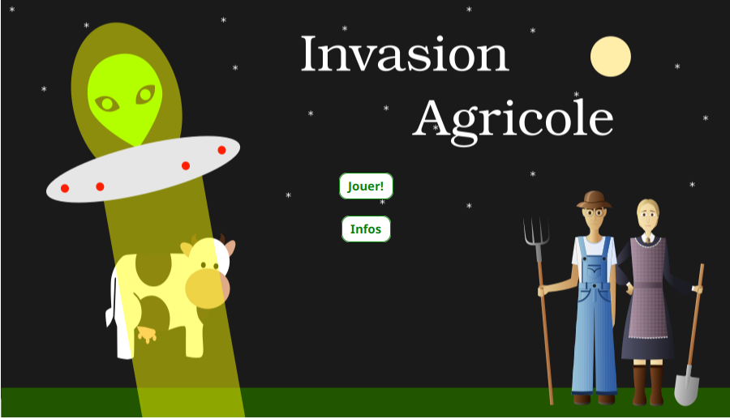
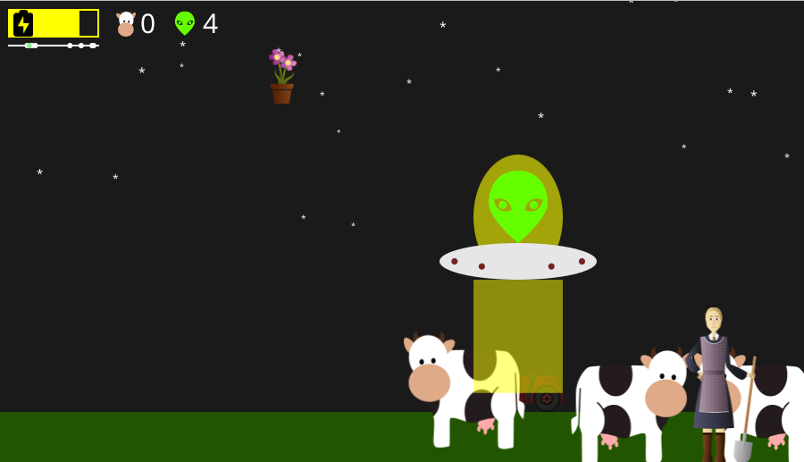
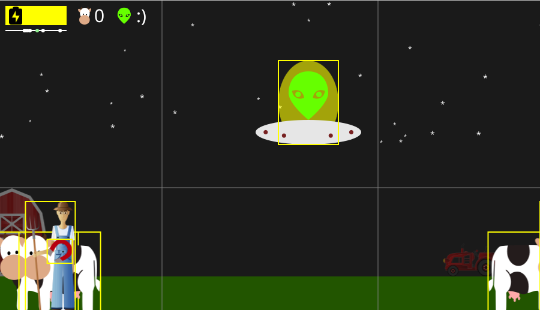
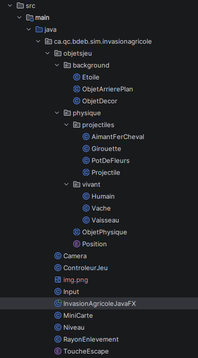

# Invasion Agricole 👽🐄

**A 2D arcade game built with Java and JavaFX, featuring custom physics, collision detection and enemy projectile behaviors.**

Pilot an alien spaceship across a nighttime farm, abduct every cow using a limited-energy tractor beam, and dodge projectiles fired by farmers. Clear the field to advance to the next level, where more cows and enemies await.

Developed as a team project by **Hayk Alaverdyan** and **Alexandre Lupascu**.

## Screenshots

### Main menu

### Gameplay

### Debug mode

## Features

- **Real-time 2D gameplay:** Control a spaceship with smooth acceleration, deceleration, and speed limits.
- **Tractor-beam mechanic:** Abduct cows using an extendable beam with energy depletion, automatic recharging, and collision detection.
- **Progressive levels:** Automatically generate cows, farmers, stars, and farm scenery. Each new level introduces more cows and farmers.
- **Distinct enemy projectiles:** Farmers launch three projectile types, including a homing horseshoe magnet with acceleration based on a modified Coulomb-law formula.
- **Physics and collisions:** Handle position, velocity, acceleration, gravity, world boundaries, and rectangular object collisions.
- **Side-scrolling camera:** Track the spaceship within a horizontal camera-follow region across a level wider than the window.
- **HUD and minimap:** Display the beam battery, remaining lives, cows collected, and approximate positions on a level overview.
- **Developer tools:** Toggle collision outlines and camera guides, invincibility, and gameplay testing shortcuts.

## Technical highlights

| Area | Implementation |
| --- | --- |
| Language and UI | Java 22, JavaFX 22.0.1, Canvas / `GraphicsContext` |
| Animation loop | JavaFX `AnimationTimer` with elapsed-time (`deltaTime`) updates |
| Architecture | Object-oriented classes for the game controller, levels, camera, input, entities, and projectiles |
| Physics | Custom motion updates and axis-aligned bounding-box collision checks |
| Projectile behaviors | Straight-line aimed projectiles, gravity-affected motion, and a magnet that tracks the spaceship |
| Build | Gradle with JavaFX and application plugins |

The shared `ObjetPhysique` base class provides common movement, rendering, and collision functionality. Specialized classes such as `Vaisseau`, `Vache`, and `Humain` extend this behavior; projectile types share a separate abstract `Projectile` base class. Game state and level progression are coordinated by `ControleurJeu` and `Niveau`.

## Controls

| Key | Action |
| --- | --- |
| **Arrow keys** | Move the spaceship |
| **Space** | Activate the tractor beam |
| **Esc** | Return to the menu while playing (or exit from the main menu) |

### Debug / testing controls

| Key | Action |
| --- | --- |
| **D** | Toggle collision boxes and camera guidelines |
| **Q** | Toggle invincibility |
| **W** | Add one life |
| **E** | Recharge the tractor-beam battery |
| **I** | Complete the current level |
| **F** | Trigger a lost level |

## Getting Started

### Requirements
- Java JDK 22
- IntelliJ IDEA (recommended) or another Java-compatible IDE

### Running the Game

**Option 1 — Using IntelliJ IDEA (Recommended)**

1. Clone or download this repository.
2. Open the project folder in IntelliJ IDEA.
3. Allow Gradle to synchronize and download the required dependencies.
4. Configure the Project SDK and Gradle JVM to Java 22.
5. Navigate to `src/main/java/ca/qc/bdeb/sim/invasionagricole/InvasionAgricoleJavaFX.java`.
6. Run the `InvasionAgricoleJavaFX` class using the green Run button.

## Project Architecture

The game is organized using object-oriented programming principles, including inheritance, abstraction, and polymorphism. Components are separated by responsibility to make the code easier to maintain and extend.

### Core Components

| Component                | Description                                                               |
| ------------------------ | ------------------------------------------------------------------------- |
| `InvasionAgricoleJavaFX` | JavaFX application entry point, scene management, and game loop.          |
| `ControleurJeu`          | Manages game state, level progression, and transitions.                   |
| `Niveau`                 | Handles level generation, entity updates, and gameplay interactions.      |
| `Camera`                 | Implements horizontal camera tracking to follow the spaceship.            |
| `MiniCarte`              | Displays the relative positions of the spaceship and cows.                |
| `Input`                  | Processes keyboard input and debugging controls.                          |
| `RayonEnlevement`        | Implements the tractor beam, collision detection, and battery management. |

### Object-Oriented Design

- **`ObjetPhysique`**: Abstract base class providing shared physics behavior, including movement, gravity, and collision detection.
- **`vivant/`**: Contains the spaceship (`Vaisseau`), cows (`Vache`), and farmers (`Humain`), each with distinct behaviors.
- **`projectiles/`**: Implements three projectile types with different movement behaviors, including homing mechanics.
- **`background/`**: Manages static scenery elements such as stars, barns, and decorative objects.

This structure allows game entities to share common physics functionality while implementing their own behaviors.

## Credits

**Developers:** Hayk Alaverdyan and Alexandre Lupascu.

Created for *420-203-RE — Développement de programmes dans un environnement graphique*, Collège de Bois-de-Boulogne. Course instructors: Nicolas Hurtubise.

Graphics were adapted from [Game-Icons.net](https://game-icons.net/) and [Openclipart](https://openclipart.org/). Original asset attribution and applicable licensing terms should be checked before redistributing the art.